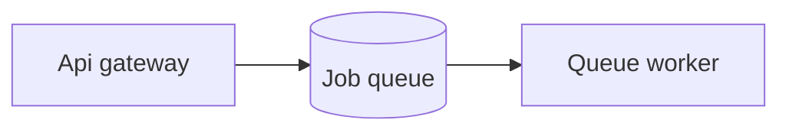

## Diagram — `Diagrams/<Area><Subject>.md`

Current state. One diagram per note, redrawn in place when the system changes. An Excalidraw drawing (`Diagrams/<Area><Subject>.excalidraw.md`) replaces this note when the user wants one they can edit by hand; its format is in [integrations.md](../integrations.md).

````markdown
---
type: diagram
status: reference
---

# <What it shows, in sentence case>

<One line: what the diagram answers, and as of when it is true.>



Source: [[<ResearchOrNoteItCameFrom>]] · `<repo-relative path or graphify-out/graph.html>`
````

Keep it to one diagram and under ~15 nodes; a bigger picture is two diagrams. Embed it where it's needed with `![[<Area><Subject>]]`.
